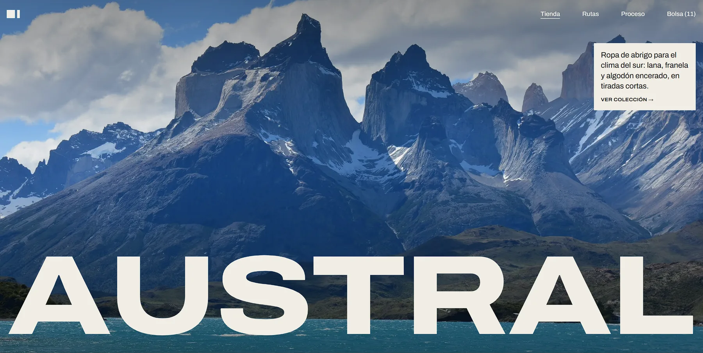

# AUSTRAL

[](https://austral-landing-six.vercel.app)

**Sitio publicado:** [austral-landing-six.vercel.app](https://austral-landing-six.vercel.app)

Prototipo de landing para una tienda e-commerce de **ropa de abrigo del sur de Chile**: parkas, chaquetas, polares, camisas de franela y prendas de punto pensadas para la lluvia, el viento y el frío de Chiloé, Aysén y Magallanes.

AUSTRAL es una **marca inventada**. El proyecto sirve para probar la idea de negocio (una tienda pequeña, de tiradas cortas, que vende prendas con nombre de lugares del sur) y para definir su identidad visual antes de construir la tienda completa.

## Qué cuenta la página

La landing está ordenada como un recorrido. Responde, en orden, qué es la marca, por qué existe, qué se puede comprar, cuál es la pieza estrella, dónde se usa, cómo se hace y cómo contactar:

1. **Hero:** foto de Torres del Paine y el wordmark de la marca.
2. **Manifiesto:** por qué existe AUSTRAL y tres datos (120 piezas por tirada, 4 talleres en Los Lagos, 5 inviernos de garantía).
3. **Categorías:** Chaquetas, Polares, Camisas, Punto y Accesorios. Cada una filtra la tienda.
4. **Tienda:** la colección otoño–invierno, con precios en pesos chilenos y la franja de tallas disponibles al pasar el ratón.
5. **Destacado:** la Parka Aysén, con su ficha técnica y el botón «Añadir a la bolsa».
6. **Rutas:** «Probado en terreno», con tres lugares, la prenda que se usó en cada uno y el clima.
7. **Proceso:** de la lana al abrigo, en cuatro pasos.
8. **Contacto.**

## Estado

Es un prototipo: la página es estática y no hay backend.

- El filtro por categoría funciona y la URL se puede compartir (`?cat=punto#tienda`).
- La bolsa es solo un contador guardado en el navegador; todavía no hay página de producto ni checkout.
- Está desplegada en Vercel: **https://austral-landing-six.vercel.app** (se vuelve a desplegar con cada push a `main`).
- Las redes sociales y el correo del footer son de ejemplo.

## Stack

- [Astro](https://astro.build) 7 con imágenes optimizadas por `astro:assets` (AVIF y WebP responsivas).
- [Tailwind CSS](https://tailwindcss.com) v4. Los tokens del sistema de diseño están en `src/styles/global.css`.
- Tipografía [Archivo](https://fonts.google.com/specimen/Archivo) (variable, con eje de anchura) vía Fontsource.
- [Lenis](https://lenis.darkroom.engineering) para el scroll suave. Se desactiva con `prefers-reduced-motion`.

## Sistema de diseño

Todo el diseño está documentado en [`DESIGN.md`](./DESIGN.md): una sola tinta (`#141414`) sobre fondo hueso (`#f1ede4`), radio 0, rejilla de 4 columnas, índices de sección numerados y motion. Para revisarlo:

```sh
npx -p @google/design.md designmd lint DESIGN.md
```

Se usa el comando `designmd` (alias del mismo paquete): en Windows, `npx @google/design.md` abre el ejecutable `design.md` como si fuera un documento Markdown en vez de ejecutarlo.

## Estructura

```text
src/
├── assets/photos/      Fotografías (ver créditos más abajo)
├── components/
│   ├── layout/         Nav (header transparente → sólido) y Footer
│   ├── sections/       Hero, Manifiesto, Categorías, Tienda, Destacado, Rutas, Proceso, Contacto
│   └── ui/             Tarjeta de producto, botones, enlaces, ficha técnica…
├── data/
│   ├── photos.ts       Catálogo de fotos con alt en español y crédito de cada autor
│   └── products.ts     Productos, categorías y pieza destacada
├── layouts/Layout.astro
├── pages/index.astro
└── styles/global.css   Tokens de Tailwind (colores, tipografía, espaciado, easing)
docs/                   Captura de la portada para este README
public/og.jpg           La misma captura, para compartir en redes (og:image)
```

## Comandos

Requiere Node 22.22 o superior y pnpm.

| Comando        | Acción                                               |
| :------------- | :--------------------------------------------------- |
| `pnpm install` | Instala las dependencias                             |
| `pnpm dev`     | Servidor de desarrollo en `localhost:4321`           |
| `pnpm build`   | Genera el sitio en `./dist/` (optimiza las imágenes) |
| `pnpm preview` | Sirve la build localmente                            |

La primera build tarda alrededor de un minuto porque genera todas las variantes de las imágenes; las siguientes usan la caché.

## Referencias

AUSTRAL es un diseño propio, pero parte de dos referencias. No se reutilizan textos, fotos ni marcas de ninguna de ellas:

- **[OUTFIT® by ++hellohello](https://outfit.hellohello.is):** de aquí viene la idea de una sola tinta sobre un fondo cálido, la rejilla editorial con huecos y el orden de la página.
- **[Graft](https://graft.framer.website), plantilla gratuita de Stacy More para Framer:** inspiró el índice tipográfico de categorías, la ficha técnica de la pieza destacada y la sección de proceso por pasos.

## Créditos de fotografía

Todas las fotos son de [Unsplash](https://unsplash.com) y se usan bajo su [licencia](https://unsplash.com/license). La clave de cada una corresponde al archivo en `src/assets/photos/` y a su entrada en `src/data/photos.ts`.

| Foto                      | Descripción                                                                    | Autor                                                             |
| :------------------------ | :----------------------------------------------------------------------------- | :---------------------------------------------------------------- |
| `hero-torres`             | Cuernos del Paine sobre un lago turquesa en Torres del Paine                   | [Adam Young](https://unsplash.com/@hossua34)                      |
| `band-chiloe`             | Isla cubierta de bosque en un canal de Chiloé con niebla                       | [Chalo Gallardo](https://unsplash.com/@chalogallardo)             |
| `iglesia-chiloe`          | Iglesia de madera chilota con su torre, sobre un prado                         | [Sebastian Olivos](https://unsplash.com/@seeeebaaa44)             |
| `ruta-torres`             | Dos caminantes con mochila en un sendero hacia las torres                      | [Toomas Tartes](https://unsplash.com/@toomastartes)               |
| `ruta-costa`              | Hombre con chaqueta frente al mar revuelto en una costa rocosa                 | [Nathan Dumlao](https://unsplash.com/@nate_dumlao)                |
| `ruta-bosque`             | Caminante con chaqueta naranja en un sendero de bosque                         | [Bryan Walker](https://unsplash.com/@bryanmillarwalker)           |
| `proceso-lana`            | Ovillo de lana y tejido a mano sobre una mesa de madera                        | [Oksana Maselko](https://unsplash.com/@oksana_maselko)            |
| `proceso-taller`          | Manos guiando una tela en una máquina de coser                                 | [alex jhonson](https://unsplash.com/@alexjhonson23e)              |
| `parka-aysen`             | Persona de espaldas con parka verde musgo caminando por un bosque nevado       | [Oleg Ivanov](https://unsplash.com/@olegivanovpht)                |
| `parka-aysen-alt`         | Persona de espaldas con parka verde y capucha de piel en una calle con árboles | [Adam Birkett](https://unsplash.com/@abrkett)                     |
| `polar-puyuhuapi`         | Mujer con polar en un campo abierto                                            | [Konrad Nowacki](https://unsplash.com/@knowacki)                  |
| `polar-puyuhuapi-alt`     | Chaqueta de polar café colgada en una pared de madera                          | [Nikola Tasic](https://unsplash.com/@tasae34)                     |
| `franela-chiloe`          | Hombre con camisa de franela a cuadros sobre una roca                          | [Brooke Cagle](https://unsplash.com/@brookecagle)                 |
| `franela-chiloe-alt`      | Camisas de franela a cuadros colgadas en un perchero                           | [Jonathan Adams](https://unsplash.com/@jonathanadamsphoto)        |
| `gorro-cochamo`           | Mano sosteniendo un gorro de lana color tabaco                                 | [Iamninoslav](https://unsplash.com/@iamninoslav)                  |
| `gorro-cochamo-alt`       | Hombre bajándose un gorro verde sobre los ojos al aire libre                   | [Danial Dezfouli](https://unsplash.com/@withdanial)               |
| `mochila-futaleufu`       | Caminante de espaldas con mochila roja frente a montañas nevadas               | [Zachary Kyra-Derksen](https://unsplash.com/@zachaery)            |
| `mochila-futaleufu-alt`   | Persona con mochila caminando entre vegetación                                 | [Holly Mandarich](https://unsplash.com/@hollymandarich)           |
| `camisa-castro`           | Hombre con barba y camisa a cuadros                                            | [Coleman Glover](https://unsplash.com/@colemangloverphotography)  |
| `camisa-castro-alt`       | Camisa a cuadros azul, blanca y café en un colgador                            | [the blowup](https://unsplash.com/@theblowup)                     |
| `chaqueta-tortel`         | Chaqueta encerada color oliva en primer plano                                  | [Kyle Loftus](https://unsplash.com/@kyleloftusstudios)            |
| `chaqueta-tortel-alt`     | Hombre con chaqueta encerada en un campo con árboles                           | [Rydale Clothing](https://unsplash.com/@rydaleclothing)           |
| `sweater-dalcahue`        | Hombre con sweater de lana oscuro                                              | [David Suarez](https://unsplash.com/@davidprspctive)              |
| `sweater-dalcahue-alt`    | Sweaters de lana doblados y apilados                                           | [Tijana Drndarski](https://unsplash.com/@izgubljenausvemiru)      |
| `chaleco-achao`           | Mujer con chaleco de punto gris sobre una camisa negra                         | [Rizky Motion](https://unsplash.com/@rizky_motion)                |
| `chaleco-achao-alt`       | Tejido de punto azul marino en las agujas                                      | [Laura Ohlman](https://unsplash.com/@ohlmanphotography)           |
| `cortavientos-torres`     | Hombre con cortavientos verde y mochila frente a montañas nevadas              | [Franco Figueroa](https://unsplash.com/@ocnarf278)                |
| `cortavientos-torres-alt` | Hombre con chaqueta negra y gorro de lana sobre una roca                       | [Tom Allport](https://unsplash.com/@t_mallp_rt)                   |
| `bufanda-natales`         | Mujer con chal tejido a crochet al aire libre                                  | [Lance Reis](https://unsplash.com/@lancereis)                     |
| `bufanda-natales-alt`     | Bufanda de lana gris enrollada sobre madera                                    | [Maria Kovalets](https://unsplash.com/@marylooo)                  |
| `guantes-cochamo`         | Mano con guante de lana tejido en la nieve                                     | [Tamara Gak](https://unsplash.com/@tamara_photography)            |
| `guantes-cochamo-alt`     | Manos con guantes blancos sosteniendo hojas secas                              | [Aren Nagulyan](https://unsplash.com/@arennagulyan_photo)         |
| `destacado-1`             | Persona con parka oscura de pie en una ladera                                  | [Ryan Kwok](https://unsplash.com/@milkbox)                        |
| `destacado-2`             | Mujer con parka negra con capucha de piel                                      | [Riccardo Agostinelli](https://unsplash.com/@riccardoagostinelli) |

## Licencia

El código está bajo la licencia [MIT](LICENSE). Las fotos no: cada una mantiene la licencia de su autor, indicada en la tabla de créditos.

## Autor

Hecho por Eduardo Apata Tito.
